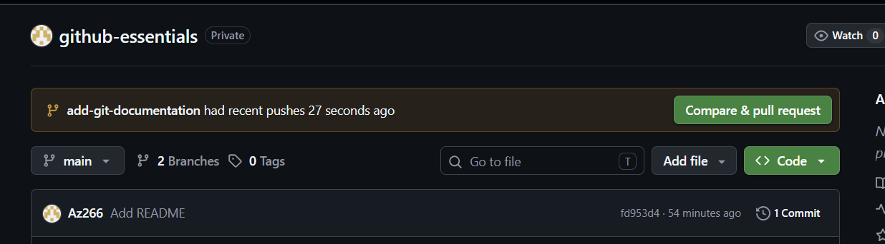
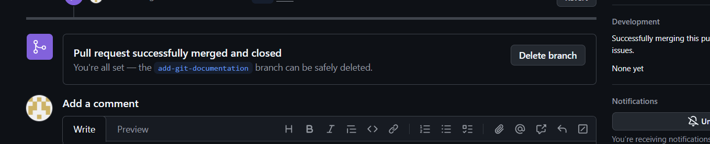
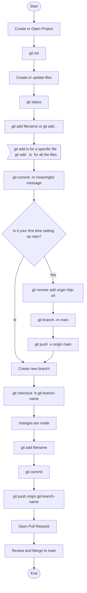
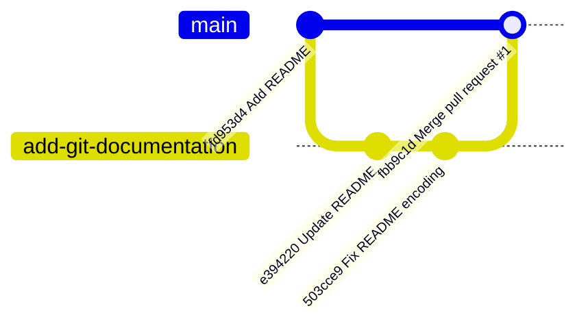

# Git & GitHub Essentials

A  guide to Git and GitHub, exploring version control, branching, commits, pull requests and collaborative project management.

## What is Git?
Git  is a **Source control management (SCM)** tool. Git allows you to manage and record changes within a file. 
Source Control or Version control is a system that records changes to files or projects over time.

Advanatages of VCS:
- Supports collaboration
- Maintains a history of changes
- Helps manage changes across projects
  

## What is GitHub?
GitHub is a platform that allows developers to  store and share Git projects. It uses Git, allowing teams to manage projects, share and clone code and collaborate remotely. 


## Please view dropdowns

<details> 
<summary><strong>Detailed Instructions: Click to reveal each step</strong></summary>
  
1. **Create a folder and open terminal**.
  I created a project folder called `github-essentials`
- `dir` lists files and folders within the current directory.
- `cd` navigates between directories.


2. **Initialised Git** when starting a new project run the command `git init`. This command creates a new repository(repo) inside my folder; allowing git to track changes, making it a version-controlled project
   after running it i saw:
```
Initialised empty git repo
```
3. **Checked the repository status** `git status` tells you what's currently going on in your repo. For a new project you'll see:

```
On branch master no commits yet nothing to commit (create/copy files and use "git add" to track)
```
This means no commits yet and no files are being tracked. The key part is that I'm on the master branch (the default branch).

4. **Added and committed README**
   Create a `README.md` file and 
   ran `git add README.md` to add only the README file. Then `git commit` to record the staged changes. Its good practice to write clear commit messages so others in a team can understand the changes made. I used `git commit -m "Add README"`

5. **Added all files** Next I ran `git add .`. The . means everything that I've saved in all files or folders.

6. **Connected the local repository to GitHub** Currently i was in my local repo and need to link my remote to my local. I added the remote origin with:
`git remote add origin https://github.com/Az266/github-essentials.git` The URL is the location of my remote repository, and origin is the name I gave it. This command tells Git where my remote repo is located.

7. **Renamed branch to main and pushed** I renamed my default branch from `master` to `main` using:
`git branch -M main`
`git push -u origin main`
This pushes my local commits to the remote repository.Now I can simply type git push and git pull in the future without repeating the remote and branch name.

</details>


<details>
<summary><strong>Creating a Branch, Pushing and Pulling</strong></summary>

The branch I created for this repository was:

- `add-git-documentation`, branch created for improving my README and demonstrating Git commands.

## 1. Creating a branch

To create a new branch and switch to it, I ran the command:

`git checkout -b add-git-documentation`

This allowed me to make changes to my README without directly affecting the main branch.

## 2. Adding and committing changes

After making changes to my README, I added and committed the file using:

- `git add README.md` and `git commit -m "Update README"`


## 3. Pushing the branch to GitHub

I pushed my branch to GitHub using:

`git push -u origin add-git-documentation`

This pushed my local branch to GitHub and linked it to the remote branch, allowing me to create a pull request.

## 4. Switching branches and pulling changes

After merging my pull request on GitHub, switch back to the main branch using:

`git checkout main`

I then pulled the merged changes into my local repository using:

`git pull origin main`

Finally, I ran `git status` to confirm that my local main branch was up to date with the remote main branch.

</details>


<details> <summary><strong> Pull Request and merging  </strong></summary>

  The figure below is a screenshot of my pull requests on GitHub:


To merge changes:
1.  Selected **Compare & pull request**
2.  Add a meaningful title and description explaining my changes
3.  Select **Create pull request**
4.  Reviewed my changes and selected **Merge pull request**.
5.  Finally, select **Confirm merge**, This merges my changes from my current branch to the main branch.
   
The screenshots below demonstrate the process of creating and merging my pull request on GitHub:






</details>


<details><summary> Rules for good comments</summary>
  
## Importance of Commit Messages:

  Commit messages are there to help programmers understand code and resolve issues in the future.
  
 ## Rules:
  1. **Use descriptive languagess**: Messages should explain what and why it has been commited.
  2. **Capitalise the First word**
  3. **Keep the messages short**
  4. **Use imperative languages**: Add, Update, Delete
  
By implementing these rules, in the future you will be able to understand what and why those changes were made.
</details>

<details><summary>Summary: Flowchart</summary>
<!--node to node lr is left to right -->

  ## Flowchart
  

</details>

<details>
<summary><strong>GitGraph: Commit History</strong></summary>

The diagram below demonstrates my practical Git workflow, including branch creation, commits and merging a pull request into the main branch.



</details>


### Table 

|   Command Names |  Description   |
|----------      |----------------|
|  git init     | Creates a local repo in the folder
|  git status     | Shows the status of your current repo; including new and modified files.
|  git add .    |  Adds all the changes made 
|  git add [specificfile] | Adds only changes from that specific file. 
|  git commit -m message | Its good practise to add comments when commiting. Comments should be meaningful 
| git branch  | Lists all the branches within your repo
|  git checkout -b name    | Creates a new branch and switches to it.
| git checkout main | Switches to the main branch. |
|git remote add origin http-url  |  Links your local repo to remote.
| git branch -m main   | Renames the current branch to main (originally was master)
| git push | Pushes your work onto github
| git pull | Pulls changes from the remote repo
| git clone | Creates a local copy

